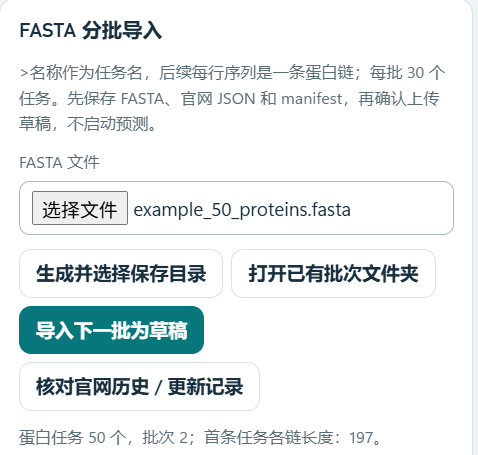
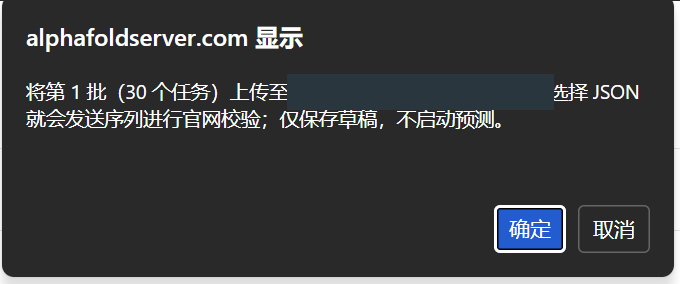
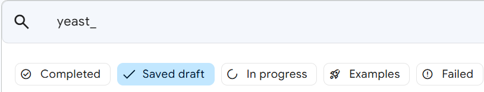
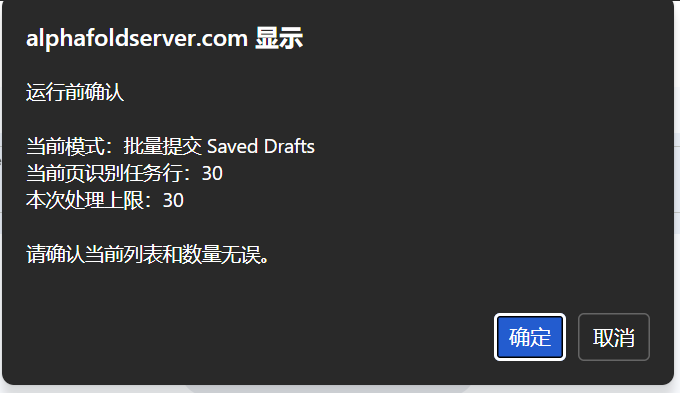
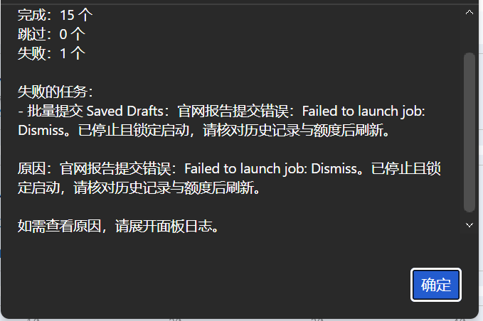
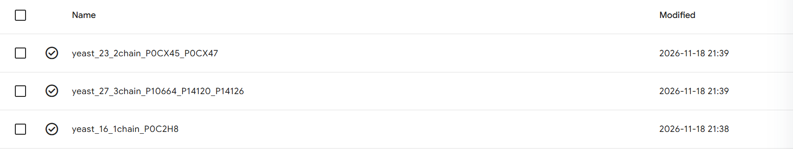

# AF3 Auto Submitter

本仓库基于 [siyuanj/af3-auto-submitter](https://github.com/siyuanj/af3-auto-submitter)，保留原作者 Jiang Siyuan 的署名和 [MIT 许可证](LICENSE)。支持 AlphaFold Server 的 FASTA 分批保存与草稿导入、Saved Drafts 批量提交、Failed jobs 克隆重提和按日期应用结果勾选。预测结果可手动使用官网原生 `Download` 下载，下载后建议集中放入一个文件夹（推荐 `results/`），再通过脚本选择该文件夹、预览结构并本地提取 CSV。

## 安装 5.0 正式版

[安装或更新 5.0.11](https://raw.githubusercontent.com/huaaaajjj/af3-auto-submitter/main/af3-auto-submitter.user.js) · [正式发布](https://github.com/huaaaajjj/af3-auto-submitter/releases) · [源码](https://github.com/huaaaajjj/af3-auto-submitter/tree/main) · [反馈问题](https://github.com/huaaaajjj/af3-auto-submitter/issues)

**从 4.0 起只发布正式版，不再维护独立开发版渠道。** 安装文件为 `af3-auto-submitter.user.js`，正常开发、安装、测试和更新均以 `main` 的正式文件为准。

**5.0.11 修复：** 草稿保存后的历史核对在完整扫描所有分页、检查同名记录后，先写入已核实的清单，再返回首页。返回首页超时不再丢失已确认的部分草稿；扫描尚未完成或同名有歧义时仍不猜认，不自动重复上传或提交预测。正式核对预算仍为 60 秒，manifest 格式仍为 1。

**5.0.10 更新：** 生成本地批次时，在 `manifest.json` 同级自动创建空的 `results/` 文件夹，用于存放官网手动下载的结果 ZIP。若创建失败则停止生成，不标记完成或启用导入；不会自动下载或改动已有结果，manifest 格式仍为 1。

**5.0.9 更新：** 面板顶部新增全局“↻ 刷新”按钮，两页均可使用；重新加载本机账户记录、补算每日预计额度，并同步官网当前显示的账号/额度、任务模式、FASTA/结果区状态、运行控件及日志。保留未保存输入、批次、结果勾选和提交锁定；不重载网页、不自动扫描官网历史，也不提交、导入或下载。读取最新服务器历史/额度仍需官网自行更新或手动刷新网页。

**5.0.8 更新：** 账户记录每天 23:00 UTC（北京时间 07:00）自动显示预计恢复 30 个；关闭页面错过刷新，下次打开补算。明确标注“待官网核实”，不覆盖上次官网实测值/时间，不累积多天额度；跨日的旧官网控件不会重新记成今日实测，更新后重新读取。只影响账户页，不修改官网配额或自动登录/提交。

**5.0.7 更新：** 日志增加 DEBUG / INFO / WARN / ERROR 分级、颜色与筛选；保留本页最近 500 条并显示淘汰数量。补充目录选择与扫描、清单关联、ZIP 解析模型/链对/耗时、CSV 实际提交、官网勾选和批次匹配等关键步骤。展开日志后可一键导出全部保留级别的 UTF-8 文本，含版本、UTC 完整时间和淘汰统计；筛选只影响显示，不缩减导出。取消/正常停止为警告，真实失败为错误；分享前请脱敏账号、任务名和文件名。

**5.0.6 更新：** 本地提取新增阶段进度条：目录扫描显示不定进度；ZIP 解析按已完成包数显示数量和百分比，当前未解析完的包不计完成；CSV 写入按成功关闭提交的文件数显示数量和百分比。ZIP 阶段 100% 不代表 CSV 已保存，各阶段分开计数，不估算剩余时间；完成、取消或出错后隐藏进度条并保留实际汇总。

**5.0.5 更新：** 移除“保存所选 ZIP 到 results…”按钮及其说明，不再由脚本下载 ZIP。请使用官网原生 Download，将下载的 ZIP 放进一个文件夹（推荐 `results/`）；“选择 ZIP 文件夹 / 提取 CSV…”每次都打开目录选择器。先扫描并确认目录结构与 ZIP 路径，再读取指标；写入前另行确认覆盖清单。独立 ZIP 文件夹无需 manifest 或登录账号；已授权的 results 可作为默认位置，但绝不跳过选择。

**5.0.4 更新：** 打开原批次目录后，日期查找结果会标注已核实的分批编号和任务数；同一天可列出多批，跨日同批分别标注。编号来自当前目录清单，不按日期顺序或名称猜测；未满足账号、名称、ID 和导入确认条件的结果不附加批次说明。“选择当前批次”无匹配时，分别提示当前账号没有批次、未确认导入、缺任务 ID 的数量，或已绑定 ID 与本次结果不匹配。

**5.0.3 更新：** 按钮操作出错时，提示文字高亮并短暂闪烁三次；开启系统「减少动态效果」时只高亮。取消、正常停止和成功不闪烁。

**5.0.2 修复：** 历史核对会对当前账号跟踪的预测任务读取其原生菜单 ID，修复核对后仍无法“选择当前批次”的问题；不按名称替代唯一 ID。草稿逐条保存时沿用剩余 60 秒核对预算，不再被内部 8 秒等待提前中断。收到提交成功后点停止，会等待该草稿行刷新再结束；没有成功回执或草稿一直未刷新仍锁定。标题左侧“−”可临时收起面板避让官网，点“+”展开；不改变已保存尺寸，处理中不可收起以保留停止按钮。

**5.0.1 更新：** “选择当前批次”位于“全选”旁，读取已打开的批次清单，按当前账号、任务 ID 和名称筛选日期查找结果，只改变面板勾选，不下载或改变官网复选框。没有匹配时清空面板勾选并提示原因。

**5.0.0 更新：** 新增“提取 results 数据为 CSV…”：浏览器本地读取 `results/*.zip`，按既有提取脚本的指标计算每包最佳模型/链对 CSV、整批最佳模型/全模型/缺失表，保留原 ZIP 和清单。自动沿用已打开批次，替换已有 CSV 前明确确认。无需 Python、官网扫描或网络请求；manifest 格式仍为 1，旧账号与面板设置继续沿用。

**4.0.7 更新：** 日志更详细：历史核对与草稿导入记录账号、筛选、每页数量、读取的名称与行数，并逐批记录已确认数、同名消歧数和未确认数；按日期查找记录起止条件与匹配结果；停止时记录原因。当前日志保留最近 500 条，并可分级筛选和导出。脚本与更新元数据同步升版。

1. 安装 Tampermonkey，点击上方正式安装链接并确认。若仅显示源码，在油猴原脚本编辑器中完整替换并保存。
2. 允许脚本在 `https://alphafoldserver.com/`（或 `https://www.alphafoldserver.com/`）运行。使用 Edge InPrivate 时，需要开启扩展的“允许在 InPrivate 中使用”。
3. 普通窗口与 InPrivate 要共用账号目录，需在 Tampermonkey 设置 > Security 中将 `Store data in incognito mode` 设为 `Permanent`。
4. 刷新官网，确认标题显示 **v5.0.11**，并核对当前账号和官网额度。网站控件与通知需使用英文。
5. 首次仅试 1 个任务；生成 JSON、导入草稿、预测提交、预测完成是四个不同阶段。结果不确定时不要重复点击 Confirm 或刷新后直接重试。

正式更新检查地址是 `main/af3-auto-submitter.meta.js`，完整下载地址是 `main/af3-auto-submitter.user.js`。启用油猴“检查更新”即可接收后续正式版本。

### 从旧版升级：先备份，不要先卸载

- 升级前通过 Tampermonkey 备份原脚本及其脚本数据。建议打开**原已安装脚本的编辑器**，以当前正式版完整源码原位替换保存，再核对账号目录；请勿先删除旧条目。只启用一份 AlphaFold 自动提交脚本。
- 旧脚本与新建脚本的 GM 存储相互独立。安装器若显示“新安装”而非更新，不能承诺账号、备注和历史额度自动迁移；保留旧条目及备份，改用原位替换。保留相同的 GM key 不等于跨脚本迁移数据。
- 4.0 保留旧版本的本地存储键，原 v3 的语言、位置、尺寸和下载方式继续读取；v2 的语言与位置在没有新记录时作为回退。网站的 www / 非 www 存储及不同浏览器配置仍互相隔离。
- `af3-auto-submitter.js` 和 `af3-auto-submitter.dev.user.js` 仅为旧地址兼容副本，与正式安装文件内容完全一致，不是额外发布渠道。旧分支的原安装地址在迁移期保留一次 4.0 更新，后续更新转往 main。
- FASTA 文件夹的 `manifest.json` 仍使用独立的格式版本 1，不随脚本版本改成 4；已有批次可通过“打开已有批次文件夹”恢复。

## 快速开始

面板顶部的“↻”刷新按钮可随时同步已加载的官网显示与本地记录，不丢失当前输入；它不是浏览器刷新，不会主动获取服务器新数据。“账户管理”的“记录当前额度”仍单独保留。

完整的图文操作步骤见[安装与使用指南](https://huaaaajjj.github.io/af3-auto-submitter/docs/tutorial/)。建议首次使用先用 1 个任务熟悉流程；确认当前账号、官网额度和目标任务后再增加数量。

1. 安装 Tampermonkey 和正式版脚本，允许脚本在 AlphaFold Server 页面运行；刷新后检查面板版本与当前账号。
2. 准备 UTF-8 FASTA：每个 `>名称` 开始一个任务，每条非空序列行各是一条蛋白链。单链不要折行；多链任务把每条链各写一行。
3. 选择 FASTA，点击“生成并选择保存目录”。这一步只在本地生成 FASTA、官网 JSON、`manifest.json` 和同级空的 `results/` 文件夹，不会上传。
4. 官网清空搜索、仅选 `Saved draft`，点击“导入下一批为草稿”。先核对账号、批次和数量，再确认；草稿保存不会启动预测。
5. 等官网草稿列表刷新后，点“核对官网历史 / 更新记录”，确认批次数量全部匹配。若提示 `Timeout`、不完整或需核对，先查看官网历史和日志，**不要立即再次导入**。
6. 只筛选要提交的草稿并核对列表、账号和额度，输入本次处理上限，点击“启动”；再次核对运行摘要后确认。提交会消耗官网额度。官网 `Completed` 后，再核对历史并记录完成状态。
7. 以后续跑时点“打开已有批次文件夹”，选直接含 `manifest.json` 的原批次目录；不要重新生成或重复上传。结果下载、保存 ZIP 和本地 CSV 操作见下文独立章节。

**重要：** 预测提交、草稿导入、提交确认和预测完成是不同阶段。停止或超时不会撤销已发出的官网请求；提交结果不明确时先查官网历史，不要反复点确认。官网列表勾选、按日期应用勾选只会改变选择，不会自动下载或提交预测。

## FASTA 分批保存与草稿导入

“FASTA 分批导入”每 30 个任务生成一份 FASTA 和 AlphaFold Server JSON，先写入用户选定目录的新子文件夹，再由用户明确确认后导入官网草稿。`manifest.json` 保留来源 SHA-256、逐行链格式与链长、原始完整标题、唯一任务名、批次文件校验值、每次导入账号/阶段/时间/错误及逐任务确认和预测状态。生成文件、上传校验、草稿导入和预测完成是不同状态。

从 4.0.1 起只按行读取纯蛋白：每个 `>名称` 开始一个任务，后面的每个非空序列行各是一条蛋白链，遇到下一个 `>` 开始新任务。无需选择链模式或末端肽长度，不拼接序列行、不自动拆肽，只生成 `proteinChain`（每链 `count: 1`）。保留每链 2700、每个任务所有链合计 3000 个残基的限制，不静默去掉 `*`、缺口或跳过非法记录。**单条长链必须写在同一行，传统 FASTA 的折行在这里会被当作不同链。** 原始文件不修改，无效记录会阻止生成并指出位置。先按 ASCII 氨基酸字母校验，再转大写，不把 Unicode 字符改造成有效残基。生成与恢复使用一致的上限：输入及单个分批文件最大 50 MiB、清单最大 50 MiB、最多 10000 批；生成前核对完整清单大小，超限不写入输出文件。

生成的批次目录结构（结果 ZIP 需通过官网手动下载后放入 `results/`）：

```text
af3_<runId>/
├── manifest.json
├── <文件名>_part001.fasta
├── <文件名>_part001.json
└── results/
```

### 标准 FASTA 示例

标准蛋白 FASTA 的每条记录由一行 `>序列名` 和接下来的氨基酸序列组成。下面是两条**独立的单链记录**，也可以直接用本脚本读取。可复制为 UTF-8 编码的 `example.fasta`；这里的短序列仅用于演示格式。

```fasta
>protein_A
ACDEFGHIKLMNPQRSTVWY
>protein_B
GAVLIPFYWSTCMNQDEKRH
```

标准 FASTA 允许把同一条序列折成多行；**本脚本会把每个非空序列行当成一条链**，所以单链不要折行。若要在本脚本中生成一个双链任务，把两条链分别写在同一个标题下面。以下是**脚本专用的多链写法**，不是标准 FASTA 的分链语法：

```fasta
>complex_one
ACDEFGHIKL
MNPQRSTVWY
```

4.0.0 已保存的单链/末端肽批次仍可打开、核对和导入，直接使用原 JSON 中已保存的链，不把旧 FASTA 的 60 字符折行重新解释为链。新清单使用 `settings.sequenceFormat: protein-lines`，仍保留原格式版本 1 和全部导入/完成记录。

### 50 个真实蛋白测试任务

本教程使用 [example_50_proteins.fasta](example_50_proteins.fasta)。文件采用本脚本的“每行一条链”写法，包含 50 个任务：单链 17 个、双链 17 个、三链 16 个，共 99 条不同序列。序列来自 UniProt 已审阅的酿酒酵母蛋白条目，标题按链顺序列出登录号；多链组合只用于测试，**不代表已知天然复合物**。首次使用仍建议先试一个任务。

| 批次 | 任务数 | 单链任务 | 双链任务 | 三链任务 |
| --- | ---: | ---: | ---: | ---: |
| 第 1 批 | 30 | 10 | 10 | 10 |
| 第 2 批 | 20 | 7 | 7 | 6 |

> **实测进度：已暂停。** 本地已生成 50 个任务；第 1 批 30 个草稿已确认导入，其中 15 个真实预测已成功完成（单链、双链、三链各 5 个），另 15 个仍为草稿。第 2 批 20 个未上传。以下为暂停前最后核实的记录，不是 50 个全部完成的结果。缺少的截图和换账号演示稍后补充。

也可阅读[安装与完整使用指南](https://huaaaajjj.github.io/af3-auto-submitter/docs/tutorial/)，其中包含安装权限、FASTA 格式、草稿导入、历史核对、预测提交、恢复批次、下载和 CSV 分析步骤。本节截图来自同一份 50 任务文件的 Edge 无痕窗口实测；ego lite 中已安装脚本，但本次暂停后未再上传或提交。截图经过裁剪，邮箱和批次标识已遮盖；不混用早先 590 任务演示的结果。

### 从头开始

1. **选择文件，生成本地批次。** 登录官网并核对账号。若浏览器没有脚本面板，先安装 Tampermonkey 和 AF3 脚本，并按浏览器提示开启用户脚本运行权限；使用无痕窗口时还需允许扩展在无痕模式运行。选择 `example_50_proteins.fasta`，点“生成并选择保存目录”，选择并授权输出父目录（实测为 `test2/`）。脚本创建新的 `af3_…/` 子目录，写出两组 FASTA/JSON 和 `manifest.json`，并创建同级空的 `results/` 文件夹，此时没有上传。

   

2. **清空搜索，只选 `Saved draft`，导入第一批。** 关闭已有官网弹窗或菜单，点“导入下一批为草稿”。核对账号、批次号和任务数后确认。本例弹窗是“第 1 批，30 个任务”。确认后才发送这一批 JSON 进行官网校验并保存草稿；这一步不会启动预测。

   

3. **核对导入，结果不明不要重传。** 本次保存后出现过 `Timeout`，最初只确认到部分记录；没有重新导入。等官网草稿列表更新后，在原账号下清空搜索、保持 `Saved draft`，点“核对官网历史 / 更新记录”，确认 30/30，面板显示“生成 50，已导入 30，已提交 0”。若仍有缺项，先查看官网历史和日志；当前筛选下未找到不等于保存失败。

   

4. **隔离目标草稿，再启动真实预测。** 导入草稿和提交预测是两个步骤。先仅选 `Saved draft`，用本批独有的任务名前缀筛选。本次搜索 `yeast_`，并逐项核对全部结果正好是新导入的 30 个任务，没有之前的草稿。**前缀只是示例；如果账号中已有同前缀任务，必须继续核对，无法隔离时不要批量启动。** 脚本每轮取当前列表首条，后续任务会补进来；官网复选框不限定提交范围，“本次数量”只是处理上限。核对当前账号和可用额度后填写数量，点“启动”并检查运行前摘要。此操作会发送真实预测请求、消耗官网额度。

   

   

5. **如实处理官网报错。** 本次计划处理上限为 30；前 15 个收到官网启动成功确认，第 16 次提交返回 `Failed to launch job`，脚本停止并锁定启动。这里汇总中的“完成 15”指 **15 个提交已确认**，不是预测已完成；“失败 1”是一次提交报错，也不等于一个已启动的预测任务失败。应先核对原账号官网历史和额度，结果不明时不要直接刷新解锁或再次提交。本次暂停后没有重试该任务。

   

6. **核对预测完成并保存记录。** 在原账号下清空搜索、取消 `Examples`，选择要核对的状态；查看成功结果可选 `Completed`。点“核对官网历史 / 更新记录”，而不是再次导入。实测官网对应的 15 个任务均为 `Succeeded`，清单已记录“已导入 30，已提交 15，已完成 15，失败 0”。这 15 个覆盖单链、双链、三链各 5 个；其余 15 个第一批任务仍为草稿，第 2 批没有上传。

   

   

### 继续上一批任务

以下是后续操作说明；**剩余 15 个预测和换账号导入第 2 批尚未完成演示**，不把计划步骤写成成功结果。

1. **打开同一个批次子目录。** 刷新页面、重新登录或换浏览器后，点“打开已有批次文件夹”，选择本次 50 任务文件对应的 `test2/af3_…/`，里面应有 `manifest.json`、`example_50_proteins_part001.fasta` / `.json` 和 `part002` 的配对文件。不要选父目录 `test2/`，也不要选早先 590 任务的目录。不必重新选择 FASTA 或再次生成 JSON；目录恢复不会迁移官网任务。

   *待补图：ego lite 中选择并恢复本次 50 任务的批次目录。*

2. **在原账号继续第一批未提交的草稿。** 第一批的 15 个已完成预测和另 15 个草稿都留在原账号。恢复后先核对账号、清单和官网历史，不要把已完成任务当成待提交任务。继续时只选 `Saved draft`，筛选并核对尚未提交的任务，数量不超过实际目标数和当前可用额度。若之前报错或结果不明，先人工核对，再决定是否刷新与继续；不是点击“启动”就自动安全重试。

   *待补图：原账号剩余草稿、重新核对后的摘要及继续结果。暂停后未执行。*

3. **在另一账号继续尚未导入的第 2 批（计划演示）。** 用户拟稍后用另一账号演示该流程；仅在官网允许的账号使用方式与额度范围内操作，不绕过限制。登录后恢复同一文件夹，核对账号和批次，确认第 2 批为“待导入”，再切到仅选 `Saved draft`，确认弹窗显示 **第 2 批、20 个任务**。此前已确认导入的第一批不会自动迁移；第一批的结果仍需回原账号核对。不要重新生成同名批次、重传第一批，或跳过“需核对历史”的批次。

   *待补图：换账号后恢复清单、第 2 批 20 个任务的确认弹窗和实际核对结果。当前第二批尚未上传。*

**暂停点记录：** 当前只有 15 个预测已确认完成；第一批另 15 个为草稿，第二批 20 个仍仅保存在本地。后续恢复前应重新读取官网状态和额度，以实际情况为准。

### 历史核对与 manifest 状态

结果不明确、停止或本地写入失败时不自动重导。已发送保存的批次不会因刷新而变为“待导入”；明确记录为“尚未发送保存”的已结束尝试可以恢复为待导入。打开已有批次文件夹时会校验清单与 FASTA/JSON 文件，内容变化或文件不全时拒绝恢复。仅凭同名的旧 `Completed` / `Failed` 记录不能证明本次已导入；脚本结合该批次的保存证据、已记录的提交结果和任务身份核对，不混用不同账号的历史。

分批按任务数而非链数计。任务名使用原标题，统一空白并替换官网不支持的字符，超过 100 字符截断；同名时加序号，原始标题与链长保留在清单中。输出 FASTA 不折行；官网 JSON 顶层是任务数组，使用 `proteinChain`、`count: 1`、空 `modelSeeds`、`dialect: alphafoldserver` 和 `version: 1`。

扫描前自动选择官网每页 100 个，等待列表刷新后开始；结束后保留 100。核对期间显示读取页数、记录数和原生进度条：官网分页总数可读且稳定时显示“已读取 / 总数”和百分比；总数不可读或变化时只显示不定进度，不估算百分比。返回首页及保存记录时显示对应阶段；结束、停止或失败后隐藏进度条。**这是历史扫描进度，不是预测完成进度。** 完成后保留本次确认数量（仅当前账号、当前筛选）并写入 `lastHistoryCheck`。账号未识别、搜索未清空、未选状态、选择了 Examples，以及处理中账号、筛选、排序、每页数量或页面地址变化时，分别提示具体原因并停止。没有脚本导入记录、账号不对应或同名任务缺少保存证据时也会说明原因。**刷新页面后先“打开已有批次文件夹”才能核对；如果已经手动上传，不要为了补记录而再次导入，同名历史不会自动关联。**

清单关键字段：

- `generationComplete`：所有分批输入文件已保存；不代表已上传。
- `revision`：清单的落盘版本号。每次写入先取得独占写入权限并核对磁盘版本；旧页面不能覆盖新导入记录，冲突时停止并要求重新打开目录。
- `batches[].attempts[]`：每次导入的账号、开始时间、校验/保存阶段、保存点击标记、结束时间、结果与错误。标记在官网保存动作**之前**写盘，防止刷新后盲目重试。
- `batches[].jobs[]`：源序号、原标题、实际任务名、链长、`importStatus`、`predictionStatus`、`importedAt` / `submittedAt` / `completedAt` / `lastSeenAt` 等。
- `importComplete`：全部任务已在对应账号官网历史中核对；不是预测完成。
- `predictionComplete`：全部任务实际核对为 Completed；`predictionFinished` 表示均已完成或失败。`summary` 分别统计生成、导入、提交、完成和失败数量。

目录访问依赖支持 File System Access 的 Edge/Chrome 和用户授权；不能通过填写任意磁盘路径绕过权限。目录句柄仅留在本次页面，刷新后需重新选择批次文件夹。所有文件和清单本地保存，不上传到第三方；只有明确确认的导入会把当前批次序列交给 AlphaFold 官网。不绕过官网容量或额度限制；FASTA 生成、导入和核对本身不下载结果 ZIP；生成、导入、核对期间与提交、下载勾选、本地提取和账号切换互斥。跟踪任务在正式提交预测前还会检查本地清单可写且版本一致；写入失败不会先消耗额度再报错。清单使用同源 Web Lock、独占写入和磁盘版本检查；仍请只在一个标签页操作同一目录，不提供跨浏览器的官网导入互斥。

## 日期折叠、勾选提速与顶部账号

已打开有效批次目录时，日期标题还会显示“第 1 批（30 个）”等编号及匹配数；同日多批分别列出，未匹配时只显示日期和任务数。批号是该目录中 `batches[].index` 的编号，不是日期排名，也不能识别其他目录的任务。归属只使用当前账号、已确认导入、任务 ID 和名称同时匹配的记录；重新打开目录、核对记录或切换语言后更新标注，保留日期展开状态和勾选。

下载匹配任务按日期默认收起，日期标题保留当天任务数量和按天勾选复选框。点击日期或使用键盘展开、收起当天明细；日期复选框只改变勾选，不切换折叠状态。折叠不改变已选任务、官网勾选或逐个下载队列；全选、清空选择和应用到官网仍包含收起的任务。切换界面语言保留已展开的日期，重新查找时默认收起。

应用到官网勾选时，只为名称和完整 Modified 时间可能匹配所选任务的行解析身份；核验时读取实际已勾选项，不再逐一打开无关旧任务的菜单。官网历史的勾选总数跨页计数；目标均有唯一 ID 且实际已核验数量与稳定的官网总数一致时提前结束，无需翻完旧历史。缺少唯一 ID 时仍遍历所有页面，核对同名同时间候选以防歧义。定位目标不依赖日期排序；目标缺失、计数不可读或发生变化时停止，仍会先清空官网已有勾选并在勾选前后重新核对身份，不使用缓存 ID 猜选。

“当前账号：邮箱”移到顶部“AF3 自动助手”旁边，不再单独占正文一行；窄面板自动换行，账号最多显示两行，悬停查看完整内容，避免极长邮箱挤掉正文。保留账号变化和语言切换后的实时更新。标题、版本和导航常驻，正文独立滚动。

## 账户管理

面板顶部增加“任务 / 账户管理”导航。默认打开任务页，保留上下常驻的提交和下载区域；切换页面不会启动或暂停任务，可随时返回任务页操作暂停、停止。导航支持方向键及 Home / End。

- 识别到当前登录账号后自动加入列表，也可手动输入邮箱、填写备注。邮箱忽略大小写、重复保存时更新备注；手动添加的账号不会推算额度。
- 当前登录账号置顶并标记“当前账号”。支持编辑备注、取消编辑、确认后移除本地记录；移除不会删除官网账号。移除当前账号后，点击“记录当前额度”可重新保存。
- 当前账号的额度只从官网请求页面的 `Remaining jobs` 读取，变更时自动保存，持续可读时最多每分钟更新记录时间；也可点击“记录当前额度”。预览弹窗的额度仍显示在任务页，不写入账户记录。
- 当日记录显示“上次记录额度”和读取时间；实测记录早于最近一次 23:00 UTC 刷新时，自动显示“预计额度：30 个，待官网核实”。页面打开时自动更新，关闭/休眠后下次打开或恢复时补算；跨月、跨年和多天未打开不累积额度。未测过的账号仍显示“尚未记录额度”。
- 自动刷新只计算账户页的本地预计值，不覆盖原官网读取值、时间或备注，不改官网配额、不触发登录/提交，也不解除提交锁定。23:00 UTC 来自公开资料的 BST 午夜换算，资料未承诺冬季安排，以官网实测为准。跨日的旧官网额度节点不会立即覆盖预计值；节点/文字更新或刷新网页后重新读取。账号切换仍需等待官网控件变化，防止错记到新账号。
- “在 InPrivate 中登录 / 切换”通过 Tampermonkey 直接打开 `https://alphafoldserver.com/`，由用户在官网操作登录；面板重新读取邮箱与额度，请核对当前邮箱。任务处理中需先停止；脚本不保存密码或登录会话。
- 账号变化会使旧下载查找结果和逐个勾选队列失效；已识别账号在提交中变化时停止并锁定启动，需要核对官网账号与历史记录后刷新。

邮箱、备注和额度记录保存在 Tampermonkey 的本机脚本存储中，同一浏览器配置内的标签页共用；不同浏览器配置不会共享记录。清除 Tampermonkey 扩展数据会删除记录。旧网站存储会在首次运行时合并导入；内容损坏时不会自动覆盖。手动添加账号只记录邮箱和备注，不支持免登录查询其他账号额度。

### 按日期勾选，再用官网下载（4.0）

1. 在官网 History 中**仅选中 `Completed`**，按需填写 `Search History`。未搜索的官网默认 Modified 倒序列表或明确的 Modified 降序，在越过开始日期后提前结束；排序无法确认时遍历所有分页，保留官网已有的复选框选中状态。
2. 在面板下方常驻的“下载任务”区域，填写开始、结束日期，点击“查找任务”。日期按官网 **`Modified` 显示的日期**筛选，包含起止当天；两项填同一天即可选择一天。
3. 查找完成后，任务按日期默认折叠；点击日期展开或收起当天任务，日期前的复选框按天勾选。展开后可逐项核对，也可用“全选”“清空选择”；折叠不改变勾选或逐个下载队列。优先读取行内 ID；没有时会逐行打开原生三点菜单、只读取 `Open results` 中的 ID，再关闭自己的菜单。同名且 Modified 时间相同的不同 ID 任务分别保留。日期无法识别的任务不纳入结果；无法安全读取菜单或任务身份冲突时停止。查找失败或结果为空时，“全选 / 清空选择”不可用，原始提示会保留。
4. 选择“合并一个 ZIP（官网最多 50 个）”或“分开下载（逐个勾选）”，再点击“应用到官网勾选”并确认替换提示。合并模式勾选全部已核对任务；分开模式每次只勾选一个任务。两种模式都**只应用勾选，不发起下载**。
5. 合并模式：手动点击官网原生批量 `Download`。分开模式：核对面板显示的当前任务名称、Modified 时间与序号，手动点击官网原生 `Download`；完成后点面板“下一任务”切换勾选，再手动下载。到最后一个任务时“下一任务”禁用。也可直接使用官网任务行的 `Download`。

**“应用到官网勾选”和“下一任务”会替换官网原有选择。** 合并模式可以应用超过 50 个任务，但官网合并 ZIP 每次最多 **50 个任务**；应用时会提示此限制，请自行减少官网勾选后再下载。脚本不自动拆批或在本地打包；这两个勾选操作不会点击官网的行下载或批量下载控件，。“下一任务”仅切换勾选，不检测文件是否下载成功。

下载方式保存在当前浏览器本地。分开模式的队列只在当前页面有效；刷新、重新查找、修改日期、面板勾选、全选、清空、下载方式或官网筛选、搜索、排序、每页数量、复选框，都会使队列失效。面板选择或官网勾选变化后请核对并重新应用；日期或官网列表条件变化后请重新查找。停止或出错不会推进队列；停止后可重新应用，出错后需重新查找。

面板上下分为“提交任务”和“下载任务”两个常驻区域，分别显示状态，均不折叠。上方仅选中 Saved draft 时显示“就绪: 提交草稿”，仅选中 Failed 时显示失败重跑就绪；下方仅选中 Completed 时显示下载就绪。单选 Completed 时上方待机，单选草稿或失败时下方待机；混选或未选标签时两边均待机。下载查找和应用的运行状态只显示在下方，匹配任务按日期默认折叠，点击日期展开或收起；日期复选框和勾选状态始终保留。

下方下载区域显示“待机 / 就绪 / 运行中”状态。点击“停止”会停止查找或应用选择。应用过程中停止或出错可能留下部分勾选，不会自动恢复旧选择；请先核对官网复选框，再决定是否下载。

按日期查找任务前自动选择官网每页 100 个，结束后保留 100；应用勾选沿用当前每页数量。查找和应用选择期间保持页面打开，不要更改官网搜索、筛选、排序或每页数量；需要调整时先停止，再重新查找。文件是否保存成功，请在手动下载后查看浏览器下载列表；浏览器询问时，按需允许官网的多个文件下载。

### 下载 ZIP 的推荐位置

结果下载只使用官网原生 `Download`；脚本不再提供独立 ZIP 保存按钮，也不会修改浏览器默认下载目录。

- 合并模式：应用官网勾选后，手动点击官网 `Download`，每次最多 50 个任务。
- 分开模式：官网下载当前任务后，点面板“下一任务”更换勾选，再手动下载。
- 推荐把下载的 ZIP 集中放在同一个 `results/` 文件夹。它可以位于原批次目录下，也可以是任何由你授权的独立文件夹；无需将 ZIP 解压。
- “选择当前批次”仍按当前目录的账号、名称和任务 ID 选择结果；只影响勾选，不下载文件。

### 选择 ZIP 文件夹并提取 CSV（5.0.5）

1. 先用官网下载 ZIP，集中放入一个文件夹（推荐 `results/`）。点 **“选择 ZIP 文件夹 / 提取 CSV…”**，每次都由你选择文件夹；无需官网扫描、任务勾选、登录账号或本地 manifest。
2. 如果本页已打开原批次且其 `results/` 可访问，选择器优先从那里打开；否则浏览器按该按钮独立的目录 ID 记住上次选择。首次仍需你选目录，脚本不能凭任意磁盘路径绕过授权，不会创建文件夹只为提供默认位置。
3. 递归扫描所选文件夹及子目录，显示目录数、ZIP 数、路径、大小和忽略的其他文件数，再问是否提取。预览最多显示 60 个目录/ZIP 路径，超出会明示数量但仍纳入扫描。**取消结构确认不会读取 ZIP 内容或写 CSV。**
4. 确认后解析 ZIP 中 job request、summary confidences 和 full data 的 JSON，并进行 CRC 和长度校验，不把整个 ZIP 解压到磁盘，不调用 Python、不发送网络请求。坏包、冲突或资源超限会停止，所有输入解析成功前不写 CSV。
5. 解析完成后另行确认输出位置和会覆盖的 CSV 路径，再写报告。每个 ZIP 的最佳模型、链对 CSV 保存在该 ZIP 旁；三张汇总表保存在**你选中的文件夹根目录**。
6. 优先关联所选目录自己的有效 manifest；仅当所选目录没有清单，且选择了本页已打开批次的 `results/` 或其子目录，也只读使用对应原清单，以保留任务顺序和缺失统计。其他已打开清单不会影响独立文件夹。未关联清单时 `in_fasta` 留空、缺失任务数显示 `—`，不把未核实的数据当作“无缺失”。
7. 可点“停止”；仅成功关闭提交的 CSV 计入已保存，已完成文件保留，未提交写入中止。多个 CSV 不是跨文件原子事务，部分完成请核对数量。源 ZIP、manifest、FASTA 和输入 JSON 不修改。

提取按钮下方显示当前阶段的原生进度条：扫描目录时总量未知，仅显示不定进度；ZIP 解析与 CSV 写入分别按“已完成 / 总数（百分比）”计数。ZIP 达到 100% 后还要汇总、确认写入和保存 CSV，不能当作整个提取完成。单个大 ZIP 处理期间百分比可能暂时不变；这是文件计数，不是字节进度或耗时预测。完成、取消或失败后隐藏进度条，状态文字保留真实保存数量。

| 输出文件 | 位置与内容 |
| --- | --- |
| `<ZIP名>_scores_best.csv` | 对应 ZIP 旁；每个 job 取 `ranking_score` 最高模型，按分数降序 |
| `<ZIP名>_scores_pairs.csv` | 对应 ZIP 旁；全部模型的有向链对 ipTM / 最小 PAE，排除对角线 |
| `all_scores.csv` | 所选目录根；跨包最佳模型。有关联清单时按原任务顺序，否则按本地 job 排序 |
| `all_scores_all_models.csv` | 所选目录根；全部模型，保留重复模型及相对路径 `source_zip` 来源 |
| `all_scores_missing.csv` | 所选目录根；有关联清单时列出缺失任务；无清单或无缺失时只写表头 |

指标包括 `iptm`、`ptm`、`ranking_score`、`fraction_disordered`、`has_clash`，动态展开的 `chain_iptm_*`、`chain_ptm_*`、非对角 `pair_iptm_*` / `pair_pae_min_*`，以及 `n_tokens`、`n_atoms`、原子 pLDDT 均值/最小值、跨链 token PAE 最小值/均值。`interface_iptm` 保留原脚本含义：第一、第二链的 `[0][1]` 值；多链完整信息看全部链对列。单包的 `long_peptide` / `short_peptide` 以及汇总的 `receptor_len` / `peptide` / `peptide_len` 分别来自请求中的**前两条序列**，不自动按长短重排，不推断是否真实受体/肽。缺失/`null` 指标留空，不伪造 0；缺少 full data 时结构指标留空。

批次汇总优先使用 job request 的原任务名匹配清单中的实际任务名，再用原脚本的小写、去非字母数字及目录 `_数字` 后缀规范化进行无歧义回退。同名 job 在不同 ZIP 中序列/链数冲突、或多个候选无法唯一匹配时拒绝生成；不会猜认。`in_fasta=yes/no` 表示本地清单匹配结果，**不是官网预测状态，也不修改完成记录**。

CSV 为 UTF-8 BOM / CRLF，字段顺序和有效数据的舍入/最佳模型规则与已有提取脚本保持一致；数字 `0` 与 `0.0` 的显示形式可能不同。含逗号、引号、换行的文本正确转义，疑似电子表格公式的文本前加单引号；数值负数不变。

**支持范围：** 使用新版 Edge/Chrome 的 File System Access、Web Locks 及 `DecompressionStream('deflate-raw')`。仅普通单卷、非 ZIP64 的 stored/deflate ZIP；单 ZIP 小于 4 GiB、中央目录最多 32 MiB，相关单个 JSON/压缩块最多 128 MiB、每包相关 JSON 解压总量最多 2 GiB；每次最多 1000 个 ZIP、100000 条模型、1000000 条链对，全部输出 CSV 总量最多 128 MiB。逐条目读取，PAE 统计不构建额外跨链矩阵；解析单个大 JSON 仍可能短暂占用主线程。加密、不支持的压缩、路径异常、重复条目、CRC/长度错误或坏 JSON 将停止整个计算，**全部输入解析成功前不写 CSV**。仅校验读取的指标条目，不验证未读取的 CIF/MSA 文件。同源页面间使用一个提取锁，防止父/子目录重叠提取；请只用一个浏览器操作同一物理文件夹。目录扫描最多 1000 个目录、100000 个条目、32 层深度，超限会明确停止。

### 提交结果确认

- 启动时和确认摘要后重新核对标签；若不再是原先单独选择的 `Saved draft` 或 `Failed`，不会启动提交。
- 草稿和 Failed 克隆重提都只点击一次 `Confirm and submit`，收到官网新的 `Job successfully launched.` 消息后才计为成功。
- 弹窗消失、行内容变化、旧成功通知均不等于本次提交成功；未知通知会继续等待，60 秒内没有明确结果就停止。
- 官网错误、提交结果超时或提交中按停止，会锁住启动按钮，防止不确定状态下重复提交。刷新会清空当前页锁定记录，因此应先核对官网记录再决定后续操作。
- 草稿收到成功消息后，还需等待该任务从列表移出；列表未更新会保留成功计数并停止，不会重复提交同一行。
- 暂停只影响后续操作，不会挂起已经发送请求的结果确认。额度不足会停止，请以官网实际提示为准。

### 面板字体、尺寸与位置

面板采用浅色工作台布局，标题 **17px**、分区标题 **15px**、日期输入和主要操作 **14px**，状态与任务名称 **13px**，辅助说明 **12px**。顶部标题和导航固定，正文独立滚动；长文本可换行，窄面板日期自动排成一列。首次使用默认尺寸为 **392 × 800px**，已有位置与尺寸记录不会被覆盖。

按住标题栏可移动面板；拖动右下角尺寸手柄可调整大小。手柄也可用键盘操作：按 Tab 聚焦后，使用方向键调节尺寸。位置与尺寸保存在当前浏览器本地，刷新后会恢复。窄屏、窗口变小或网页缩放时，面板会约束在视口内。

本地存储被浏览器禁用时，当前页面仍可调整尺寸；刷新后恢复尺寸需要本地存储可用。面板标题显示当前正式版本号，便于核对更新。

### 当前账号邮箱与官网额度

面板在顶部“AF3 自动助手”旁显示“当前账号：邮箱”，窄面板下自动换行。优先读取官网账号控件中的邮箱，控件未显示时读取官网页面初始化数据中的当前账号邮箱；每次状态更新时重新读取，支持页面中的账号变化。未登录、邮箱缺失或账号信息有歧义时显示“未识别”，不将上次邮箱显示为当前账号。顶部账号最多显示两行，悬停查看完整内容；完整邮箱也保留在可访问文本和账户管理页中。

面板实时读取当前页面的 `Remaining jobs`，打开任务预览时优先显示预览中的额度。账号切换或页面 DOM 更新后会重新读取；读取不到或存在歧义时显示“无法识别”，不会把未知额度当作 `0`。这是官网页面所显示的额度，脚本不会自行推算或增加额度。

邮箱与额度仅读取当前官网页面内容，不额外请求官网接口、不读取 Cookie。脚本会在本地保存邮箱、备注、额度及记录时间，不上传账号或任务数据。

### 保留的面板功能

保留中文及其他五种界面语言、运行前摘要、暂停/继续/停止、完成汇总和可折叠日志。提交锁定只覆盖当前页面，不提供跨标签页或跨浏览器互斥。

### 操作日志：分级、筛选与导出（5.0.7）

1. 点面板底部 **“日志”** 展开。默认显示全部级别，可在“日志级别”中选择：
   - **DEBUG / 调试**：菜单定位、分页、ZIP 读取/解析、写入开始等步骤。每包解析记录文件名、字节数、模型数、有向链对数及耗时；不逐模型或逐残基刷日志。
   - **INFO / 信息**：开始操作、扫描汇总、清单关联、官网选择核验结果、CSV 成功提交及最终汇总。提交日志只在官网确认后报成功；CSV 只在文件成功关闭提交后计数。
   - **WARN / 警告**：用户取消/正常停止、缺少选择或任务 ID 等需要处理但不代表程序故障的情况。
   - **ERROR / 错误**：官网报错、解析/写入失败、本地记录保存失败或未完成文件清理失败。即使之前保存了一部分，也会保留错误与实际完成数。
2. 点 **“导出全部日志”**，在浏览器下载列表核对 `af3-logs-v版本-时间.txt`。导出包含**当前保留的全部级别**，不受界面筛选影响，带脚本版本、UTC 导出时间、完整 ISO 8601 日志时间和淘汰条数。仅点击按钮时才创建本地下载，不会自动发送到外部服务。
3. 本页最多保留 **500 条**；达到上限后淘汰最早记录并显示数量。日志仅在当前页面内存中，刷新/关闭会清空；重建面板或切换语言不会清空，排查前请及时导出。
4. 日志不保存密码或 Cookie；完整 HTTP(S) 链接会省略，控制字符会转义，网站文字和文件名按纯文本渲染。但日志仍可能含**账号邮箱、任务名与本地文件名**，对外分享前请检查并脱敏。导出只表示已请求浏览器下载，不声称操作系统已经成功保存。

## 验证与排查

本地验证使用完整正式脚本和隔离浏览器合成页面，不访问 AlphaFold、不使用登录资料、不消耗预测额度：

```bash
node --check af3-auto-submitter.user.js
python -I -X utf8 test_release.py
python -I -X utf8 test_submission.py
python -I -X utf8 test_download.py
python -I -X utf8 test_fasta.py
python -I -X utf8 test_select_batch.py
python -I -X utf8 test_score_extraction.py
node test_score_core.mjs
git diff --check
```

浏览器回归共 296 个场景（提交与账户 36、原有下载 139、FASTA 55、当前批次选择 16、本地指标提取 50）。另有无依赖的指标核心检查，覆盖舍入、CSV 转义及单/多链统计。完整检查包含真实的 60 秒等待，需要数分钟。文件系统大部分采用内存句柄模拟；另有原生 Edge 独占写入与 Web Lock 检查，不等于真实账号端到端验证。新版本在真实官网首次仍只试一个任务。

面板不显示时先核对版本、站点权限并确认只启用一份脚本。额度显示“无法识别”不等于额度为零。提交结果不确定、部分导入或锁定时，先人工核对官网记录，再决定后续操作；不要用反复启动代替确认。

## 文件与发布流程

- `af3-auto-submitter.user.js`：唯一正式安装和测试源文件。
- `af3-auto-submitter.meta.js`：与正式文件一致的更新元数据头。
- `af3-auto-submitter.js`、`af3-auto-submitter.dev.user.js`：字节一致的旧地址兼容副本；修改正式文件后同步，不单独开发。
- `test_release.py`：版本、更新地址、grants、元数据和兼容副本一致性检查。
- `test_submission.py`、`test_download.py`、`test_fasta.py`、`test_select_batch.py`、`test_score_extraction.py`：账号无关的完整浏览器回归；原有下载测试仍禁止传输，本地提取使用合成 ZIP 验证目录确认、指标和写入安全。`test_score_core.mjs` 检查舍入、匹配、单/多链与 CSV 边界。
- `index.html`：中文正式安装说明。
- `init.png`、`saved_draft.png`、`failed.png`：历史参考截图，不代表当前界面或版本。

正式版本合入 main、全部检查通过后以 `v版本号` 标签和 GitHub Release 发布；不再单独迭代开发版。上游链接仅用于来源说明，安装和更新均来自本仓库。
